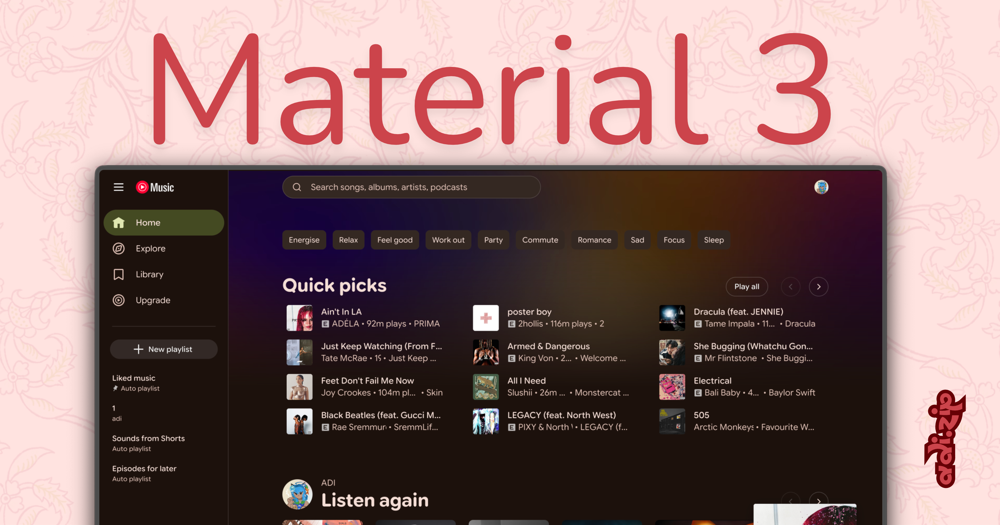

# Material 3

A Material 3-inspired theme for Better Lyrics on YouTube Music.

## Features

- Dark interface with expressive, colorful accents
- Google Sans Flex (Rounded)
- Dynamic color styling inspired by Material You
- Material 3 expressive loading indicator replacing the default spinner
- Credits: adidotzip | VincentPardy (M3 Expressive Progress + theme rewrite / cleanup) ❤️
- Minimal layout designed to keep lyrics easy to read 

## Preview

### Home

### Lyrics

### Explore

## Credits

Created by [adidotzip](https://github.com/adidotzip) with [VincentPardy](https://github.com/VincentPardy)
